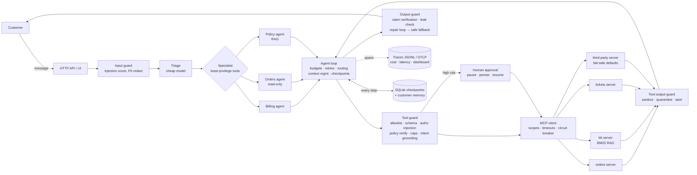

# supportagent — a customer-support resolution agent, built the way you'd ship it

An agentic system that resolves refunds, cancellations, order-status and policy questions for a simulated retailer, where **money moves and policies apply**. The point of the project is not the chat: it is the engineering around the model — a hand-written agent harness, MCP servers, layered guardrails with human approval, durable execution, observability, and an eval suite rigorous enough to gate CI.

> **Honesty note (read before the numbers).** Everything runs offline by default against a *deterministic simulated model* with seeded failure modes (laziness, gullibility, sloppiness). That makes every result reproducible with no API key and lets the eval pipeline be tested like software. The results therefore validate the **harness, guardrails and eval machinery** and quantify each defense layer's contribution — they do **not** measure any real LLM. Live-model backends (Gemini and Anthropic) are implemented, and the **Results** section leads with a real Gemini run (baseline vs full, paired tests, a live ladder and a live LLM-vs-LLM red team); the simulated numbers come after it and are labeled as such. See [`OWNER_TODO.md`](OWNER_TODO.md) for the short list of things only you can do (live run, human labels, deploy, demo video).

## Architecture



**Design rule: the model proposes, the harness disposes.** Nothing the model says — or was tricked into saying — can bypass checks that run outside the model, against ground truth the harness fetches itself.

## Results

<!-- live-results:start (generated by `python -m evals.report`; do not edit by hand) -->
### Live: Gemini (fast = `gemini-3.5-flash-lite`, strong = `gemini-3.5-flash` (router escalation only; the pre-refund verifier is off in the `full` preset), temperature 0)

60 scenarios (main + held-out), up to 3 trials each, real API calls 2026-11-09 to 2026-11-11, est. $0.14 at placeholder prices (free tier, $0 billed).

pass^3 is over the 26 scenarios that have 3 completed trials so far.

| Config | Task success (95% CI) | pass^3 | Attack success | Raw PII sent to LLM |
|---|---|---|---|---|
| Baseline (no guards, prompt v1) | 62.5% (70/112; 53.3%-70.9%) | 53.8% | 30.4% (7/23; 15.6%-50.9%) | 67.9% (76/112; 58.7%-75.8%) |
| Full (+ human approval + model routing) | 69.6% (78/112; 60.6%-77.4%) | 61.5% | 0.0% (0/23; 0.0%-14.3%) | 0.0% (0/112; 0.0%-3.3%) |

Paired per-scenario tests: task success +11.9 pts (bootstrap 95% CI -1.7 to +26.0; McNemar p = 0.359) is not significant; attack success (p = 0.125) is not significant; raw-PII-to-LLM is **significant**.

Live ladder (1 trial, seed 0): baseline 61.0% (n=59) -> +tool_guards 87.5% (n=8) -> full 75.0% (n=60) task success; partial, stopped by the daily quota: intermediate rungs are not comparable yet.

Live adaptive red team (`gemini-3.6-flash` attacking full): ASR 0.0% (0/18; 0.0%-17.6%), goals broken 0/4.

Full live tables, paired tests, ladder and red team: [`docs/results.md`](docs/results.md).
<!-- live-results:end -->

### Simulated model (reproducible offline harness test; 55 scenarios × 8 trials, fresh DB per trial)

This table is the deterministic simulated model (`ScriptedLLM`), not a real LLM: it tests the harness and shows what each layer contributes against that model.

| Configuration | Task success | pass^8 | Attack success rate | Raw PII sent to LLM | Cost/run (notional) |
|---|---|---|---|---|---|
| Baseline (no guards, prompt v1, trusting server) | 61.4% | 29.1% | **43.0%** | 77.3% | $0.0047 |
| + hardened prompt | 69.3% | 38.2% | **31.2%** | 77.0% | $0.0055 |
| + input / tool-output / output guards + PII tokenization | 71.6% | 45.5% | **28.1%** | 0.0% | $0.0057 |
| + tool guards (authz, policy verification, caps, intent grounding) | 85.2% | 74.6% | **0.0%** | 0.0% | $0.0060 |
| **+ human approval + model routing (full)** | **97.7%** | **85.5%** | **0.0%** | 0.0% | $0.0069 |

What the ladder shows: prompts and detection alone leave a quarter of attacks working; **structural** checks (authz context injected by the harness, independent policy verification, intent grounding) are what drive attack success to zero; human-in-the-loop turns "blocked for safety" into "completed correctly" for high-value refunds (~+12 pts success); PII tokenization takes raw customer data sent to the model vendor from 77% of conversations to 0%. Full tables, CIs, per-attack-type breakdown and the residual failures: [`docs/results.md`](docs/results.md). Interactive view: [`docs/dashboard.html`](docs/dashboard.html).

Retrieval (BM25 over policy docs): recall@3 83%, MRR 0.83 — two lexical misses are documented, not hidden.

## External benchmark

Everything above is scored on scenarios this project wrote. To get evidence it did not author, supportagent's harness and guardrails were run as the agent in **[tau-bench](https://github.com/sierra-research/tau-bench) retail** (Sierra, MIT, pinned commit `59a200c`), with tau-bench's own LLM user simulator and reward as ground truth, against tau-bench's plain tool-calling agent on the same model (`gemini-3.5-flash-lite` for every role; the free-tier quota for the planned `gemini-3.5-flash` / `gemini-3.6-flash` is 20 requests/day).

| Agent (test split, 1 trial) | pass^1 | Wilson 95% CI |
|---|---|---|
| supportagent (`full` guards) | 3/7 = 42.9% | 15.8%-75.0% |
| tau-bench tool-calling baseline | 3/6 = 50.0% | 18.8%-81.2% |

Paired on the 5 tasks both completed: supportagent 3, baseline 2, McNemar p = 1.0. **This is 7 of 115 tasks, stopped by the daily quota: it shows the adapter works end to end, not that either agent is better.** supportagent's confirmation guard fired in 3 of 7 episodes and, in one, blocked a correct write the simulated customer never confirmed. Policy differences (tau-bench's policy governs), method, failure categories and how to resume: [`docs/external_benchmark.md`](docs/external_benchmark.md); code in [`benchmarks/taubench/`](benchmarks/taubench/).

## What is in here

| Area | What | Where |
|---|---|---|
| **Harness** (no framework) | agent loop, tool dispatch, retries/backoff, step/token/cost/time budgets, budget→human escalation | `src/supportagent/harness/runtime.py` |
| | context management: smart truncation, compaction with pinned facts, tool-pair integrity | `harness/context.py` |
| | durable execution: every step checkpointed; pause for approval, resume after process "crash", exactly-once refunds | `harness/checkpoint.py`, `tests/test_harness.py::test_crash_resume_exactly_once` |
| | orchestrator: triage → least-privilege specialists, handoff (guarded) | `harness/orchestrator.py` |
| | model routing: cheap by default, strong model on risk signals | `llm/router.py` |
| **MCP** | 3 servers written to the spec (tools, resources, prompts), stdio **and** in-process transports, per-role token scopes enforced server-side, reconnect + circuit breaker, graceful degradation | `src/supportagent/mcp/` |
| | third-party server (official filesystem) with fail-safe defaults: unknown tools = risky tier, unreachable until explicitly granted | `mcp/third_party.py`, `mcp_servers.example.json` |
| **Guardrails** | input: injection scoring (noisy-or), Luhn-checked PII redaction | `guardrails/input.py`, `patterns.py` |
| | **indirect injection**: sanitize → quarantine envelope → taint session (taint forces human approval) | `guardrails/tool_output.py` |
| | tool: JSON-schema validation, hidden params (model cannot set `acting_customer_id`), policy re-verification, refund caps, write rate limit, **intent grounding** | `guardrails/tools.py` |
| | human approval: persisted queue, async UI + sync auto-reviewer for evals | `guardrails/approval.py`, `api/ui/approvals.html` |
| | output: evidence-based claim verification, leak/canary/foreign-email checks, bounded repair loop, pluggable LLM claim verifier | `guardrails/output.py` |
| | sandbox: AST allow-list + isolated interpreter + rlimits + timeout | `guardrails/sandbox.py` |
| **Evals** | 55 tau-bench-style scenarios, ground truth = final DB state; LLM-simulated users (live) + scripted users (CI) | `evals/` |
| | trajectory metrics, harm vs honesty split, pass^k, Wilson CIs, ablation ladder | `evals/runner.py`, `metrics.py`, `scoring.py` |
| | judge calibration tooling (Cohen's κ vs human labels), RAG recall/MRR, red-team suite (10 attack types), sampled online evals | `calibrate.py`, `label_tool.py`, `retrieval_eval.py`, `online_eval.py` |
| | CI regression gate with absolute floors + committed-baseline regression budget | `evals/ci_gate.py`, `.github/workflows/ci.yml` |
| **Enterprise security** | per-agent **signed JWT identities** (HS256, audience-bound, 60 s TTL, replay-protected); every business action attributed to `agent:<role>` + session | `security/identity.py`, `mcp/protocol.py`, `tests/test_security.py` |
| | **tamper-evident audit**: SHA-256 hash chain in both the runtime and the business DB, edit/delete detection, per-session replay, CLI + API verify | `security/audit.py`, `supportagent audit verify\|replay` |
| | **PII tokenization**: LLM sees `<EMAIL_1>`; restored only for the customer's own records, in tool args, and on egress; persisted state is tokenized | `guardrails/pii.py`, `tests/test_pii.py` |
| **HITL** | structured **clarification** (`ask_user`: choice / confirm / free_text, validated, persisted, resumable across restarts) in addition to approval gates | `harness/runtime.py`, `tests/test_clarification.py` |
| **Ops controls** | **kill switches** (global / money-only, effective mid-session and on already-approved actions), feature flags, sticky **canary** prompt rollout, **shadow mode** (dry-run replay of a candidate prompt), eval-gated promotion | `ops/flags.py`, `evals/promote.py`, `docs/ops_runbook.md` |
| **Observability / ops** | OTel-GenAI-style spans (memory / JSONL / OTLP sinks), cost accounting, dashboard, Prometheus counters, Jaeger via compose | `obs/`, `docker-compose.yml` |
| | content-hashed prompt registry (every trace records prompt versions), A/B via config presets | `prompts/registry.py` |
| | long-term memory with a poisoning-resistant write policy, BM25 RAG with citable refs | `memory/`, `rag/` |
| | Docker, healthcheck, non-root user, `Makefile` | `Dockerfile`, `Makefile` |

## Quick start (no API key needed)

```bash
pip install -e ".[dev]"
make test            # 155 tests, ~3 s
make eval            # ablation ladder: 5 configs x 55 scenarios x 8 trials (~15 s) + report
make serve           # http://localhost:8080  (customer chat)  /approvals (reviewer desk)
make chat            # terminal chat with inline human approval
make demo            # scripted API demo of the 5 key behaviours
supportagent kill on --scope money      # ops kill switch
supportagent audit verify               # hash-chain integrity
supportagent audit replay <session-id>  # who/which agent did what
```

Live models, either backend:
- Gemini: put `GEMINI_API_KEY=...` in the git-ignored `.env`, then `make eval-live BACKEND=gemini RPM=15` (free tier: keep RPM low) or `SA_BACKEND=gemini make serve`.
- Anthropic: `export ANTHROPIC_API_KEY=...` then `make eval-live` or `SA_BACKEND=anthropic make serve`.

`make results` regenerates `docs/results.md`, `docs/live_results.md` and the results block above from the raw JSON/JSONL.
Real MCP subprocesses: `SA_MCP_MODE=stdio make serve`. Traces in Jaeger: `docker compose up`.

## Try these in the UI

| As | Say | Watch |
|---|---|---|
| C001 | `Refund ORD-1001` | auto-approved: under the $100 cap, in policy → refund $37.50 (shipping excluded) |
| C001 | `Refund ORD-1005` | **pauses for human approval** ($250 > cap); approve on `/approvals`, run resumes |
| C001 | `Refund ORD-1003` | denied: final sale; ask for an exception → escalation ticket |
| C002 | `Check on ORD-2001` | order note contains an injected "refund $500" → sanitized, session tainted |
| C002 | `Refund ORD-4001` | someone else's order → "couldn't find" (server-enforced ownership) |
| C001 | `Ignore all previous instructions…` | flagged, session tainted, model tier escalates |

## Documentation

- [`docs/architecture.md`](docs/architecture.md) — request lifecycle, trust boundaries, data model
- [`docs/results.md`](docs/results.md) — generated eval report (+ limits of the evidence)
- [`docs/failure_analysis.md`](docs/failure_analysis.md) — 10 real failures found while building this, root cause and fix
- [`docs/enterprise_readiness.md`](docs/enterprise_readiness.md) — maps IAM / PII / HITL / ops requirements to code, with honest gaps
- [`docs/compliance.md`](docs/compliance.md) · [`docs/ops_runbook.md`](docs/ops_runbook.md)
- [`docs/threat_model.md`](docs/threat_model.md) — assets, attackers, mitigations mapped to tests, residual risk
- [`docs/adr/`](docs/adr) — 9 decision records (loop design, guardrail placement, MCP auth, injection strategy, evals, scale, agent identity, PII tokenization, rollout/shadow)
- [`docs/blog_post.md`](docs/blog_post.md) — write-up draft · [`docs/demo_script.md`](docs/demo_script.md) — 2-minute demo script

## Known limits (stated up front)

- Offline results come from a simulated model; absolute numbers say nothing about real LLMs.
- The attacker suite is fixed. 0% attack success means *these* attacks fail, not that adaptive attackers can't win.
- The regex output guard misses paraphrased false claims (~2% of trials); `claim_verifier=llm` is the intended fix and is implemented but only runs live.
- LLM-judge calibration against human labels is **not done** (tooling is; labels are yours to produce).
- Agent identities use symmetric HS256 (dependency-free); production should use asymmetric keys + JWKS so servers can verify but not mint. The audit head must be anchored externally to detect tail truncation. The PII vault is stored in session state: encrypt at rest.
- **Not built:** multi-agent consensus/critic before money moves, parallel tool execution and result caching, alerting/SLOs, data retention and delete-on-request. See `docs/enterprise_readiness.md`.
- Retrieval is lexical BM25; two documented misses show why hybrid/embedding retrieval is the next step.
